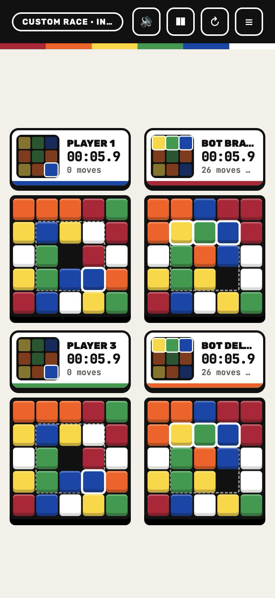

# Rub4Race

A colour-sliding puzzle **race** in the classic Rubik's cube palette. Designed and built by **ASROYAL**.
Everyone gets the same shuffled 5×5 board and the same 3×3 target pattern. Slide tiles into the gap until the
**centre 3×3 square** of your board matches the target. First one done wins.



## Modes

| Mode | What it is |
|------|-----------|
| **Solo** | Race the clock; your personal best is saved. |
| **vs Computer** | Human vs a bot that really solves the puzzle (Easy / Medium / Hard / Insane). |
| **2 Players** | Human vs human on one keyboard. |
| **4 Players** | Four racers, one screen. |

Every seat can be set to **Human / Computer / Off**, so you can mix e.g. 2 humans + 2 bots.

## Controls

| Seat | Keys (slide a tile) |
|------|------|
| Player 1 | Arrow keys |
| Player 2 | `W` `A` `S` `D` |
| Player 3 | `I` `J` `K` `L` |
| Player 4 | `T` `F` `G` `H` |

Or click / tap any tile next to the gap. Tick **Invert keys** to move the gap instead of the tiles. `Esc` pauses.

## Features

- Smooth sliding animation, glowing tiles when they match, live progress on the target preview
- 3-2-1 countdown, confetti, rankings and per-session win counts
- BFS-based CPU opponent with adjustable skill
- Light and dark mode (follows your system, toggle in the corner), colour-blind symbols, sound toggle, responsive layout (desktop and mobile)

## Run it

No build step. Just open `index.html`, or serve the folder:

```bash
python3 -m http.server 5173
```

Then visit http://localhost:5173.

## Credits

Design, code and bot AI: **ASROYAL** © 2026.

Unofficial fan project. "Rubik's" and "Rubik's Race" are trademarks of their respective owners, and this project is not affiliated with them.
